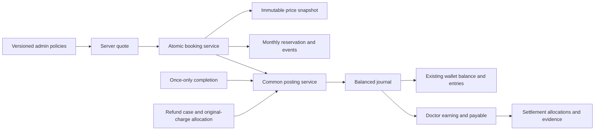

# Financial schema and transaction design

Date: 2026-11-20. **Proposed technical design, not implemented.** Commercial policy authority remains [BUSINESS_RULES.md](BUSINESS_RULES.md) and [ADR 0002](adr/0002-monthly-quota-and-refund-policy.md). See [ADR 0003](adr/0003-financial-schema-and-compatibility.md) and the separate [rollout specification](FINANCIAL_COMPATIBILITY_ROLLOUT.md).

First implementation review: [G1A operation identity](DORMANT_FINANCIAL_SLICE_REVIEW.md), [ADR 0005](adr/0005-first-dormant-financial-slice.md). This narrows the first dormant addition to one immutable identity table. Execution state/results and other G1 families remain separate future slices; no schema implementation is claimed.

## 1. Existing records to retain

| Existing record | Keep / extend | Do not do |
| --- | --- | --- |
| `Consultation` | Keep PK, participants, source, workflow and histories; add financial engine version and snapshot reference | Infer engine from current configuration or rewrite completed bookings |
| `ConsultationFinance` | Keep historical fields; add snapshot/operation links and explicitly versioned projection rules | Reinterpret legacy `doctor_fee` as the new independent payable |
| `Payment` | Keep one-to-one consultation record and existing wallet/provider status contract | Create a new Payment row for every refund/follow-up/attempt or assume PAID means gateway cash received |
| `PatientWallet`, `TMCAccount` | Keep one account/balance per existing owner; add ledger-account/checkpoint link | Introduce another spendable balance or migrate identifiers |
| Wallet/account entries | Retain history and API types; new entries reference posting/operation and original/reversal | Erase FREE_RECORD rows or append another debit just to mirror the journal |
| Recharge request records | Keep request/approval and gateway references; add unique funding operation links | Treat a pending request as verified funds or reconcile it twice |
| `DoctorEarning` | Retain one original-consultation earning, add engine/snapshot/journal provenance and settlement/adjustment relations | Recompute historical earnings or overwrite an EARNED/SETTLED amount on retry |
| `AdminPlatformAccount/Entry` | Preserve legacy evidence and reports; inventory its meaning at cutover | Treat its arithmetic balance as a bank account or require it to fund a doctor's accrual |
| Events/follow-up sessions/prescriptions | Keep identifiers, role access, original scope and version history | Reuse a new consultation completion to charge/pay a follow-up a second time |

## 2. Shared field and integrity conventions

- Keep existing integer identifiers; proposed new records also expose immutable UUID references. All timestamps timezone-aware, UTC storage, allowance boundaries Asia/Kolkata. Currency fixed to INR for this rollout; multi-currency is not implied.
- Proposed monetary storage `Decimal(14,2)` for new records; percentages `Decimal(7,4)`, range 0-100. Existing 10/12-digit fields must not overflow when projected: validate against their capacity until a separately reviewed additive widening migration is deployed. No floats.
- Proposed rounding is ROUND_HALF_UP once at each resolved INR amount; derive charge from rounded reference minus rounded discount, not independently rounded competing formulas. Persist rounding/calculation version. This is a technical proposal for review, not a claim about current arithmetic.
- All financial records carry actor/system origin, created/occurred times, operation reference, provenance (`NATIVE_V2`, `LEGACY_OBSERVED`, `LEGACY_OPENING`, `UNRESOLVED`) and relevant source record IDs. Store no clinical notes or raw secrets in journal metadata.
- Use restrictive/protected relations for new financial evidence. Existing user/profile/consultation cascade-delete paths require a deletion audit before rollout: archive/deactivate actors instead of deleting ledger history. Do not silently change old foreign keys during unrelated work.
- Posted snapshots, journal lines, policy versions and evidence events are immutable; correct by new version/reversal/adjustment. Enforce at database/write-service boundaries and Django admin, not only by hiding UI inputs. Store mutable processing status separately from immutable monetary evidence.

## 3. Commercial policy and quote records

Names below are proposed model names, not files or migrations that already exist.

| Record | Minimum fields | Constraints and behaviour |
| --- | --- | --- |
| `DoctorCommercialPolicy` | doctor, version, effective interval, reference_fee, direct_price, payable_mode/value, settlement_frequency, published_by/at, supersedes | Unique doctor/version; one unambiguous published policy at a time. Publish under a doctor/policy-owner lock and validate interval overlap. Published versions immutable. Explicit zero is different from missing. |
| `TMCCommercialPolicy` | TMC, version/effective interval, discount_mode NONE/FLAT/PERCENT, discount_value, monthly_free_limit, published_by/at | Unique TMC/version; no stacking. No automatic import of lifetime discount quotas into recurring rights. Per-doctor override/discount caps remain gated by P04. |
| `ConsultationQuote` | public ID, requester, patient/doctor/TMC/source, currency, policy versions, resolved amounts, proposed quota allocation, calculation version, expires_at, payload digest | Quote is advisory, not a quota reservation or money hold. Caller/participants bound to quote. Expiry window is configuration reviewed before implementation. A changed price or exhausted free slot requires a fresh quote and acceptance. |
| `ConsultationPriceSnapshot` | consultation UNIQUE, quote, source, payer, policy IDs and copied values, reference_fee, patient_charge, tmc_charge, tmc_discount_amount, free_benefit_amount/reason, doctor_payable, quota allocation, booked_at, rounding_version | Created in booking transaction, immutable. Exactly one payer/source contract: DIRECT has no TMC fields or quota; TMC has actual TMC and zero direct charge. Preserve explicit zeros. |

Doctor payable modes: `FIXED_AMOUNT` or `REFERENCE_LESS_PERCENT` (100 reference less 20% = 80 payable). Do not confuse retention percentage with payable percentage. Validate payable nonnegative and independent of payer charge; no cap against TMC charge (which may be zero). Any proposed cap against reference price needs explicit review, not silent clamping.

TMC paid charge: reference less valid flat/percentage discount, with no implicit extra platform surcharge. Reject discount exceeding reference rather than silently creating a negative charge. Quota-free benefit and paid discount are separate reporting categories; never sum them as two earned commissions for one charge. A zero price produced by a promotion/100% discount needs its own reason and does not automatically consume a monthly slot. Quota-vs-discount selection precedence must be explicit before activation; the current free-first behaviour is a compatibility starting point, not approval of all old discount quotas.

Only authorised admin commercial actions publish policy. Doctor public/profile editing does not publish independent platform payout terms. A quote resolver must not infer missing payout terms from `DoctorProfile.consultation_fee` or an incoming `amount`.

## 4. Period allocations and reservation evidence

| Record | Minimum fields | Constraints / transitions |
| --- | --- | --- |
| `TMCQuotaAllocation` | TMC, local month start, timezone, UTC start/end, policy version, granted_units, amendment version | Unique TMC/local month; nonnegative units, start < end. On-demand idempotent generation under TMC/allocation lock, with optional scheduler using the same service. No lifetime-counter reset. |
| `TMCQuotaReservation` | consultation UNIQUE, allocation, status RESERVED/CONSUMED/RELEASED, lifecycle timestamps, original grant reference | One active reservation per booking. Convert only once; terminal release cannot later consume. All counter changes lock allocation and reservation. |
| `TMCQuotaEvent` | allocation/reservation, kind GRANTED/AMENDED/RESERVED/CONSUMED/RELEASED/EXPIRED, units, operation, actor/reason | Unique operation/event type per affected resource; immutable history. Expired units are not a grant to the next month. |

While a period is open: available = grant minus currently reserved minus consumed, subject to auditable amendments. After period end: available for new bookings = zero, even if an old reservation is later released. Committed reservations remain fulfilable in the original period. Expiry markers and jobs are idempotent; calendar eligibility must work even if a scheduled job was missed.

Proposed safe amendment behaviour: adding units creates a referenced amendment; reduction cannot invalidate existing reservations/consumption or make availability negative. Mid-month amendment business/UI behaviour remains a review gate. Failed booking rolls back reservation and debit together. Monthly allocation must be created for an explicit admin entitlement only; no implied joining allowance.

## 5. Journal, operations and wallet projections

| Record | Minimum fields | Constraint / index |
| --- | --- | --- |
| `FinancialOperation` | Immutable UUID, kind, typed actor/system scope, idempotency_key, versioned request digest, creation time | G1A contract in ADR 0005: unique scope/kind/key; no execution status/resource/result fields in this identity. Future separate execution/result records and services must compare fingerprints, handle replay/conflict and enforce resource uniqueness before any live writer. |
| `LedgerAccount` | UUID, account type, currency, owner/resource link where applicable, legacy link | Unique account purpose/owner/currency. Owner-type consistency; public serializers never expose other owners' accounts. |
| `JournalTransaction` | UUID, operation, purpose, currency, occurred/posted times, original/reversal link, source entity | Unique operation/purpose/resource. A transaction can have several balanced lines; no blanket one-transaction-per-operation restriction. |
| `JournalLine` | transaction, account, debit, credit, source/allocation reference | Exactly one positive side; nonnegative amounts, same currency, journal/account indexes. Posted transaction debit sum equals credit sum; drafts never affect balances. |
| `FinancialOutboxItem` | operation/action key, resource, processing state, attempt count, next retry, lease expiry, redacted result | Unique business action; durable claim/retry without holding posting locks across network calls. |

Cross-line balance cannot be proved by a single row check. Implementation must validate the complete batch and prevent partial posted commits through a reviewed database enforcement mechanism (for example deferred transaction-level validation). Account balances and cumulative wallet projections update in the same database transaction as all journal lines and the existing API entry. No mutable draft is spendable.

Wallet account balance remains a cached projection of its liability ledger after a reconciled opening. Every credit/debit creates exactly one existing wallet entry referencing its journal posting. Zero-charge bookings retain their FREE_RECORD/event contract without artificial zero-value journal lines. Existing lifetime credited/debited totals are preserved across opening imports; distinguish lifetime totals from new-ledger-period totals.

No real bank balance is invented for manual credits. Verified external receipts can use gateway clearing/bank evidence. Manual grants or unresolved legacy credits use a separately labelled funding/suspense account with reason/provenance until reviewed. Do not call an unexplained adjustment revenue or cash.

### Balanced posting examples

`Dr`/`Cr` are accounting sides, not API debit/credit labels. Each row balances separately. Amounts INR; payer wallet is either the TMC or direct patient's liability account.

| Event | Debit | Credit |
| --- | --- | --- |
| Verified gateway wallet funding 500 | Gateway clearing 500 | Payer wallet liability 500 |
| Book paid consultation for 70 | Payer wallet liability 70 | Consultation deferred revenue 70 |
| Complete that consultation | Deferred revenue 70 | Consultation revenue 70 |
| Accrue independent doctor payable 50 | Clinical service expense 50 | Doctor payable liability 50 |
| Cancel before start, return the 70 | Deferred revenue 70 | Original payer wallet liability 70 |
| Complete free TMC consultation | Clinical service expense 50 | Doctor payable liability 50 |
| Confirm actual doctor settlement 50 | Doctor payable liability 50 | Bank/verified disbursement clearing 50 |
| Gateway settles 500 with evidenced fees 10 | Bank 490 and gateway fee expense 10 | Gateway clearing 500 |

Booking/consumption and wallet recharge are not the same revenue event. Free TMC service creates no fictitious revenue/discount cash entry; its contribution is -50 before other costs. Paid 70 with payable 50 produces contribution 20. Direct 100 with payable 80 produces 20. TMC discount benefit is metadata/economic benefit, not an additional payable.

For approved post-completion refunds: debit contra-revenue/refund expense as classified, credit refund payable; confirmed return then debits refund payable and credits original payer wallet liability or bank/provider clearing. Doctor payable adjustments are separate approved entries, never implicitly netted into a patient refund. For a provider refund before service, debit deferred revenue and credit refund payable at approval; clear that payable only on confirmed provider return. Unknown legacy accounting needs a reviewed mapping/suspense route, not these new-engine templates applied blindly.

## 6. Refund, gateway and settlement record families

| Record | Minimum fields | Protection |
| --- | --- | --- |
| `RefundCase` | consultation, reason category, eligibility/decision, requested/approved totals, actor/reason/evidence references, processing status | Automatic pre-start entitlement separated from admin exceptions. No evidence of provider completion inferred from approval. |
| `RefundAllocation` | case, original debit/payment, payer/destination, amount, reservation/confirmation status, journal links | Sum confirmed + in-flight reservations <= original refundable amount, enforced under original-charge lock. Multiple partial allocations supported; no double wallet/provider return. |
| `RefundAttempt` | allocation, action key, provider ref, redacted status/error, attempt timestamps | Timeout keeps amount reserved until reconciliation; failed attempts do not erase approval or create a new entitlement. |
| `GatewayEvent` | provider/account namespace, event ID UNIQUE within namespace, received/verified time, payload digest/minimal redacted evidence, processing state/error | Verify signature before processing, validate payment/order/amount/currency and status; event ordering/replay cannot double-credit. Bad/unverified events have no posting authority. |
| `DoctorEarningAdjustment` | earning, signed adjustment, journal, case/approval/reason | Append-only; original earning retained. Separate earned, adjusted, reserved for settlement and confirmed paid amounts. |
| `DoctorSettlementBatch` | doctor, period bounds, state DRAFT/APPROVED/PROCESSING/PARTIAL/PAID/FAILED, actor and evidence | Period/calendar is admin policy, not a claim that a scheduled date is a transfer. |
| `DoctorSettlementAllocation` | batch, earning, amount, reserved/paid state, journal links | Per-earning allocations cannot exceed adjusted unpaid payable; lock earnings and existing reservations. |
| `DoctorSettlementAttempt` | batch/allocation, manual verified reference or provider key, amount/state/time | First release records verified manual payouts only. Prevent duplicate external references in the correct provider/account namespace; no automatic bank transfer. |

Retain original single-consultation `Payment` as a compatibility summary; new allocations/attempts carry many-to-one evidence. Follow-up earnings/prices are not silently squeezed into its one-to-one structure. Defer new follow-up commercial logic until P07 is decided, but route existing follow-up wallet mutations through the unified posting adapter.

## 7. Service start evidence (proposed technical mechanism)

Introduce append-only `ConsultationServiceEvidence`: consultation, scope ORIGINAL or explicit follow-up session, kind START_ATTESTED/PARTICIPANT_ACK/DISPUTED/ADMIN_REVIEWED, server timestamp, actor, channel, operation, related event and superseding evidence reference. A scope-specific start projection is derived separately; unique start-operation prevents repeated clicks becoming repeated billable sessions.

- Assigned doctor explicitly selects “Begin consultation”; server checks membership, allowed booking state and original/follow-up scope, records a server timestamp and attestation. No arbitrary backdated client timestamp.
- Patient or assigned TMC sees that start and may acknowledge/dispute. Proposed acknowledgement is not a mandatory booking block; it is additional evidence. Owner/UI review is required before enforcing this mechanism.
- Acceptance/queue auto-transition, message sending, prescription changes, SDK room creation, or one participant joining video do not automatically create authoritative financial service-start evidence.
- Keep existing scheduling statuses. Original-booking completion for the new engine requires the reviewed evidence path or an explicit admin exception; legacy bookings without new evidence remain legacy and use review where needed.
- Disputed/missing/conflicting evidence invokes ADR 0002 admin review, never a fabricated start, auto-denial or an automatic cancellation fee.

An automatic pre-start cancellation is eligible only with reliable new-engine evidence that service has not begun and no exception/no-show case; in ambiguous/legacy cases create a review case. The absence of an imported start row is not proof that legacy service never happened.

## 8. Transaction boundaries, concurrency and permissions

All mutation entry points call services, not bespoke balance arithmetic. Establish a documented resource order before implementation: operation reservation; policy-owner/doctor admission locks when needed; consultation/scope; TMC allocation; wallet/ledger accounts in stable sorted order; earnings, charge/refund/settlement allocation rows in stable order. Pre-create account anchors; do not rely on locking a nonexistent row. Any additional rows discovered during a transaction must respect that order or trigger a bounded retry from the start.

Booking: reserve/replay operation, validate compatible quote and participant scope, lock policy version/admission resources, validate schedule/open-consultation constraints, create booking/snapshot, reserve quota, verify TMC balance >= max(100, charge), post charge/journal/API entry and return result atomically. Direct wallet verifies actual charge coverage. If quote conditions change, abort with a re-quote response; do not silently charge the fallback paid price. Doctor selection changes require accepted re-quote, not reuse of the old doctor's payout snapshot.

Completion: lock original consultation/scope, enforce evidence/permissions, mark completion once, consume quota, recognise deferred revenue and accrue doctor payable once. Follow-up completion must not repeat original revenue/payable. Cancellation serializes on that same scope and creates the appropriate case/release/return once; stale competing completion cannot earn afterward.

Webhook/checkout: authenticate event or callback, reserve original funding business operation, verify external captured outcome/amount, post credit once. Different provider events for the same payment share resource uniqueness. HTTP/outbox work occurs outside locks; confirmation posts in a fresh transaction. Staff manual approval and webhook processing use the same funding idempotency guard.

Role rules: admin commercial/payout/refund decisions require explicit staff permission and audit; assigned doctor controls its service start/completion; patient/owning TMC can act only on authorised bookings and own funding; gateway has signature-based event authority only. New payout amounts/internal accounts/identity documents must not leak into patient/TMC/public serializers. Existing coarse staff access needs a reviewed permission map rather than a blanket public API expansion.

Index policy: owner/effective version, period/TMC, operation uniqueness, account+posting time+ID, consultation/scope, gateway namespace/event and payment reference, refund original charge/status and doctor earning/settlement status/time. Use explicit stable index names to avoid repeating the marketing drift issue. Exact SQL/model definitions, locking tests and query plans belong to implementation review.
